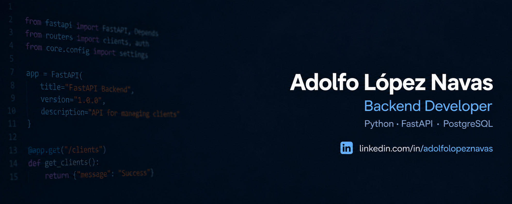

<a href="./README.md">English</a> · Español

  <a href="https://www.linkedin.com/in/adolfolopeznavas/">LinkedIn</a> ·
  <a href="https://github.com/adolfoln98-bit?tab=repositories">Repositorios</a>

---

Desarrollo APIs REST con Python y FastAPI, prestando especial atención al modelado de datos, las reglas de negocio y las pruebas automatizadas.

Soy Técnico Superior en Desarrollo de Aplicaciones Web (DAW). A través de mis proyectos propios, trabajo con autenticación, control de acceso, bases de datos relacionales y operaciones transaccionales.

**Busco oportunidades de desarrollo backend en Madrid o en remoto dentro de España.**

## Stack principal

**Backend** · Python, FastAPI, Pydantic, APIs REST  
**Datos** · PostgreSQL, SQLite, SQLAlchemy, Alembic  
**Autenticación y acceso** · JWT, OAuth2, permisos por roles, acceso por propietario del recurso  
**Pruebas y herramientas** · Pytest, TestClient, Git, GitHub, Swagger / OpenAPI

## Proyectos destacados

### [Perfumes Store](https://github.com/adolfoln98-bit/perfumes-store)

Backend de comercio electrónico para una tienda de perfumes. **En desarrollo.**

- Modelo de datos relacional con usuarios, marcas, perfumes, carritos y pedidos.
- Lógica de compra que comprueba el stock, registra el precio unitario de compra, actualiza el inventario y vacía el carrito dentro de una transacción de base de datos.
- Capas de repositorio y servicio, con pruebas automatizadas de pedidos correctos y casos como carritos vacíos o stock insuficiente.

`Python` · `FastAPI` · `PostgreSQL` · `SQLAlchemy` · `Alembic` · `Pytest`

### [Client Management API](https://github.com/adolfoln98-bit/client-management-api)

API REST para gestionar registros de clientes. **Finalizada.**

- Autenticación JWT, roles de usuario y administrador y acceso según la propiedad de los recursos.
- Operaciones CRUD con validaciones, filtros, paginación y ordenación.
- Pruebas automatizadas y documentación interactiva de la API.

`Python` · `FastAPI` · `SQLite` · `Pydantic` · `Pytest`

[Explorar la documentación de la API](https://client-management-api-hhpj.onrender.com/docs)

## Mi forma de trabajar

Mantengo las reglas de negocio en la capa de servicio y el acceso a datos en los repositorios. Utilizo pruebas para comprobar el comportamiento esperado, los casos de error y los cambios persistidos, y priorizo diseños sencillos que respondan a las necesidades actuales del proyecto.

## Contacto

Puedes encontrarme en [LinkedIn](https://www.linkedin.com/in/adolfolopeznavas/).
Email: adolfoln98@gmail.com
